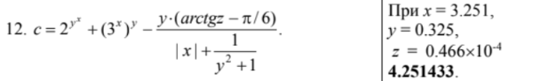
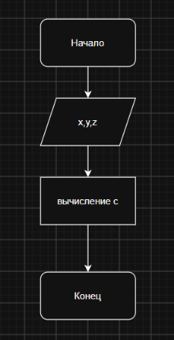

# Домашняя работа             
# Варинат 12
### Условие: 

### Вывод: В ходе выполнения программы была составлена формула для вычисления значения по заданным значениям x, y и z. Для вычислений использовались математические функции возведения в степень, арктангенса и модуля числа. В результате работы программы при заданных исходных данных получено значение c=4.251433
